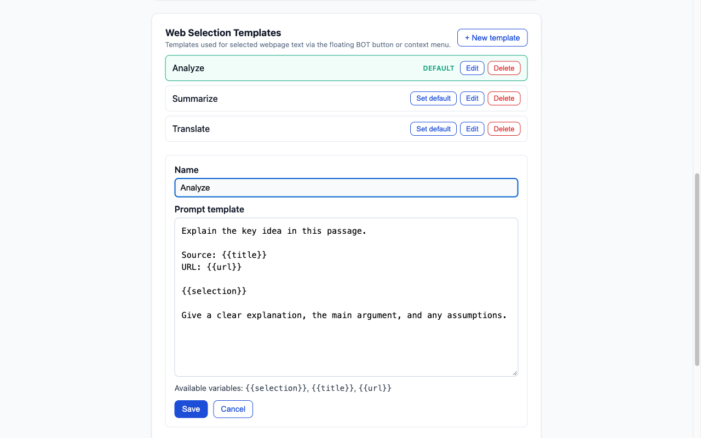

# ChatGPT Web Injector


A free, MIT-licensed Chrome extension for YouTube transcripts, subtitle downloads, and reusable ChatGPT prompts.

[Install from the Chrome Web Store](https://chromewebstore.google.com/detail/clkggcckiepbgbjlgboapakmipmbgojk) · [Source code](https://github.com/shrk7x/chatgpt-web-injector) · [Report an issue](https://github.com/shrk7x/chatgpt-web-injector/issues)

---

## Features

### 🎬 YouTube AI Helper

Injected controls appear next to the YouTube player's CC button — no extra clicks needed.

- **AI Summary**: Opens a ChatGPT tab pre-loaded with the full video transcript, ready to summarize or ask questions.
- **Transcript Panel**: Toggles the native YouTube transcript sidebar.
- **Download Subtitles**: Choose your format from a popover:
  - **SRT** — precise SubRip format with millisecond timestamps (`00:00:12,345`), sorted chronologically. Good for subtitle editors or archiving.
  - **TXT** — readable plain text with timestamps. Useful for notes or prompts.
- Transcript tools depend on caption availability. Controls hide when the extension can determine that captions are unavailable.
- Handles YouTube's single-page navigation — no stale buttons or race conditions when switching between videos.

### 📋 Prompt Templates

Edit your default prompt template from the extension's Options page.

Available variables:

| Variable | Description |
|---|---|
| `{{selection}}` | The text you selected |
| `{{title}}` | Page title |
| `{{url}}` | Page URL |

Example template:

```
You are a precise analysis assistant.

Source: {{title}}
URL: {{url}}

Selected content:
{{selection}}

Please provide:
1) Key conclusion
2) Potential logic gaps
3) Confidence level
```

### 🖱️ Send Selection to ChatGPT

Two ways to trigger:

- **Right-click** any selected text → **Send to ChatGPT**
- **Floating button** (BOT): optionally enable it in Options to show a shortcut near your selected text

Both open ChatGPT in a new tab, inject the composed prompt, and auto-send. If injection fails, a manual copy modal appears as a fallback.

---

## Screenshots

Public video content and sample templates captured in a separate, signed-out demo environment.




---

## Installation

1. Clone this repository
2. Open Chrome → `chrome://extensions`
3. Enable **Developer mode**
4. Click **Load unpacked**
5. Select this project folder

---

## Privacy

- No backend, no API key, no analytics
- Settings and templates saved through Chrome synchronized extension storage (`chrome.storage.sync`)
- Selected text, transcripts, and source context are sent to ChatGPT when you initiate a send or summary action
- No separate extension account or API key; ChatGPT sign-in requirements and usage limits still apply
- Temporary Chat is optional and follows ChatGPT's own data policies

---

## Automatic Chrome Web Store releases

Every Monday at **09:00 America/Denver** (including daylight saving changes),
the Release workflow refreshes the release-please PR. If there are pending
releasable changes, it tests that exact PR revision, squash merges it, and creates
a GitHub Release and ZIP in the same workflow. If no release PR is pending, it
skips publication. Failed tests or a changed PR head stop the release. GitHub may
delay scheduled runs; the scheduled time is not a delivery guarantee.

Pushes to `main` continue to update the release PR without publishing each change.
Unreleased changes remain queued until the next successful weekly run. Version
numbers and changelog entries still come from Conventional Commits: `fix:` bumps
the patch, `feat:` bumps the minor, and documentation-only changes do not normally
create a release. For an early release or an end-to-end check, open GitHub Actions
→ **Release** → **Run workflow** on `main`, enable **publish_pending**, and leave
**release_tag** empty. This executes the same test, automatic merge, packaging and
store submission steps as the weekly schedule. Without that checkbox, a manual
run only refreshes release-please. You can also merge the Release PR manually.

Merging the release-please Release PR creates a GitHub Release and its ZIP. The
`publish-store` job downloads that exact ZIP, checks its version, runs the tests,
uploads it using Chrome Web Store API v2, and submits it with `DEFAULT_PUBLISH`.
Google publishes it automatically after approval. `PENDING_REVIEW` in the Actions
summary means submitted, **not yet live**. Chrome delivers approved updates on
its own schedule; unpacked development copies do not receive store updates.

### One-time authorization

Publishing uses [Google Workload Identity Federation](https://github.com/google-github-actions/auth)
with a dedicated service account. GitHub exchanges its job identity for a
short-lived access token scoped to `https://www.googleapis.com/auth/chromewebstore`.
No service-account key, OAuth client secret, or refresh token is stored in GitHub.

1. Enable Chrome Web Store API, IAM Service Account Credentials API, and Security
   Token Service API in the Google Cloud project.
2. Create a dedicated service account and a GitHub OIDC workload identity provider.
   Restrict the provider to this repository's immutable repository ID and owner
   ID, `refs/heads/main`, and `.github/workflows/release.yml@refs/heads/main`.
   Grant that repository principal `roles/iam.workloadIdentityUser` on the service
   account. No project-level roles are needed by the service account.
3. In Chrome Web Store Developer Dashboard → Account, link the service-account
   email. Google currently allows one service account per publisher: preserve an
   existing binding rather than replacing it without checking its use. This grants
   access to the publisher's items; the workflow targets the extension ID below.
4. Configure these **repository Variables** under GitHub Settings → Secrets and
   variables → Actions:

   | Variable | Value |
   |---|---|
   | `CHROME_EXTENSION_ID` | `clkggcckiepbgbjlgboapakmipmbgojk` |
   | `CHROME_PUBLISHER_ID` | `90c1b37a-7a2d-463b-81b4-41b87afe7c5e` |
   | `CHROME_SERVICE_ACCOUNT` | `chrome-store-publisher@gen-lang-client-0871900312.iam.gserviceaccount.com` |
   | `CHROME_WORKLOAD_IDENTITY_PROVIDER` | `projects/800999186027/locations/global/workloadIdentityPools/chatgpt-store-github/providers/github-main` |

   Confirm publisher ID in Developer Dashboard → Publisher → Settings. The store
   listing and privacy information must already be complete. Dispatch from `main`;
   the Google identity provider rejects tokens from other branches and workflows.

See Google's [service-account setup](https://developer.chrome.com/docs/webstore/service-accounts).
For a local diagnostic, pass a short-lived `CHROME_ACCESS_TOKEN` and the two item
IDs as environment variables to the publisher script; never put tokens in command
arguments or commit them.

### Retry a failed submission

Open GitHub Actions → **Release** → **Run workflow** on `main`, and enter the exact
existing tag in `release_tag` (for example `chatgpt-web-injector-v0.1.1`; legacy
`v0.0.18` tags also work). This retries only store publishing without creating a
new version. Leaving the field empty runs release-please as before.

The workflow serializes store submissions. It skips a version already published
or awaiting review, and stops if another version is awaiting review or staged.
Authentication failures, HTTP errors, failed/timed-out uploads, and unexpected
submission states fail the job. Inspect Actions and the Developer Dashboard,
resolve the problem, then dispatch again. For a Google review rejection, fix the
reported issue and release a new version. The GitHub Release ZIP remains available
for manual upload if needed.

---

## Contributing

Issues and PRs are welcome.

If a selector breaks due to a YouTube or ChatGPT UI update, please open an issue with:
- Browser version
- Page URL
- Screenshot (if possible)
- Expected vs actual behavior

---

## License

MIT

### Choose ChatGPT or Gemini

Choose **AI assistant** in the extension popup or Options. ChatGPT is the default;
Gemini opens `https://gemini.google.com/app`. The choice saves immediately and
applies to the floating BOT button, context menu, and YouTube summaries. Templates
are shared between both assistants. Temporary Chat is available only for ChatGPT
YouTube summaries; its preference is preserved when switching to Gemini.

Gemini must be signed in and its composer available. The extension inserts the
full multiline prompt, clicks Send once, and waits for the matching user message.
Sign-in screens, changed website controls, or delayed responses can prevent
confirmation. Check the conversation before manually sending again. If automation
fails, Options opens with the full prompt and a Copy button; pending prompts are
also available by opening Options later. Recovery prompts stay in local extension
storage (never sync storage or URLs) until a confirmed send or **Delete saved
prompt**. Reload the extension and refresh existing tabs after updating.

If local recovery storage is unavailable, automatic sending pauses and a manual
copy dialog opens in the assistant tab. If that tab cannot be opened or injected,
the extension toolbar shows an error badge and a title explaining that the source
text must be selected again. A cleanup failure after a confirmed send never
triggers another submission or an unconfirmed-send recovery tab.
